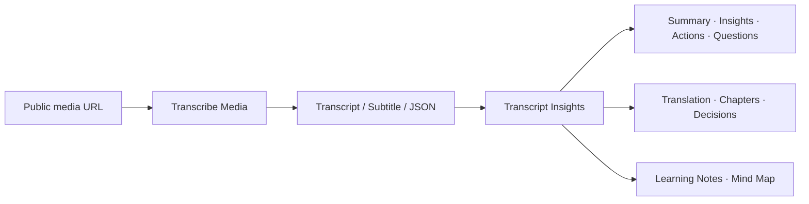

# Video Transcriber AI Skills

Official Agent Skills from [Video Transcriber AI](https://videotranscriber.ai/) — transcribe public media and turn transcripts into structured knowledge.

[](LICENSE)

[English](README.md) | [简体中文](README_zh.md)

## What are Agent Skills?

Agent Skills are reusable instructions, references, and optional tools that teach an AI agent how to perform a workflow consistently. This repository maintains one canonical Skill source that works with Codex, Claude Code, and other Agent Skills-compatible tools.

## Available Skills

### transcribe-media

Use the Video Transcriber AI MCP server to:

- transcribe public audio, video, and supported platform URLs
- choose basic or advanced transcription
- request speaker diarization, audio events, speech cleanup, and keyterms
- generate chapters or translations
- retrieve transcripts and SRT/VTT subtitle links
- resume an existing transcription task safely

This Skill requires a configured Video Transcriber AI MCP connection and consumes API Quota when it creates a task.

### transcript-insights

Transform transcripts and subtitles into:

- Executive Summary
- Key Insights
- Action Items
- Open Questions
- Translation
- Chapters
- Key Decisions
- Learning Notes
- Mind Map

When no output type is specified, the Skill returns Executive Summary, Key Insights, Action Items, and Open Questions.

## Workflow



## Demo

Official input:

[`official-video-subtitles.srt`](examples/transcript-insights/official-video-subtitles.srt) is sourced from the Video Transcriber AI official product video, [*Transcribe Video to Text from 2-Hour YouTube Videos with AI*](https://www.youtube.com/watch?v=e8WaTlzuid0).

Request:

```text
Use $transcript-insights to generate an Executive Summary, Key Insights, Chapters, Learning Notes, and a Mind Map.
```

See the complete [official expected output](examples/transcript-insights/official-video-expected-output.md).

The repository also includes a [workshop capability test](examples/transcript-insights/expected-output.md) for testing action items, decisions, missing deadlines, and anti-fabrication behavior.

## Installation

Review third-party Skills before installing them. The commands below install this repository from its public GitHub source.

### ChatGPT Desktop and Codex

Add the repository marketplace:

```bash
codex plugin marketplace add VideoTranscriberAI/videotranscriber-skills
```

Install the Plugin:

```bash
codex plugin add videotranscriber-skills@video-transcriber-ai
```

In the ChatGPT desktop app, open the Plugins Directory, select the **Video Transcriber AI** marketplace, and install **Video Transcriber AI Skills**.

### Codex CLI — Skill only

Clone the repository and copy or symlink the Skill into the Codex user Skills directory:

```bash
git clone https://github.com/VideoTranscriberAI/videotranscriber-skills.git
mkdir -p ~/.agents/skills
cp -R videotranscriber-skills/skills/transcript-insights ~/.agents/skills/
cp -R videotranscriber-skills/skills/transcribe-media ~/.agents/skills/
```

Restart Codex if the Skill does not appear immediately.

### Claude Code Plugin

Inside Claude Code:

```text
/plugin marketplace add VideoTranscriberAI/videotranscriber-skills
/plugin install videotranscriber-skills@video-transcriber-ai
/reload-plugins
```

The Plugin Skill is available as:

```text
/videotranscriber-skills:transcript-insights
/videotranscriber-skills:transcribe-media
```

### Claude Code — Skill only

```bash
git clone https://github.com/VideoTranscriberAI/videotranscriber-skills.git
mkdir -p ~/.claude/skills
cp -R videotranscriber-skills/skills/transcript-insights ~/.claude/skills/
cp -R videotranscriber-skills/skills/transcribe-media ~/.claude/skills/
```

The standalone Skills are available as `/transcript-insights` and `/transcribe-media`.

### Agent Skills CLI

For supported agents such as Codex, Claude Code, Cursor, GitHub Copilot, Windsurf, Gemini CLI, and Cline:

```bash
npx skills add VideoTranscriberAI/videotranscriber-skills
```

Follow the CLI prompt to select `transcribe-media`, `transcript-insights`, or both, and choose the target agents.

### Manual project installation

Copy the desired directory from `skills/` to the project-specific Skills directory used by your agent:

- Codex: `.agents/skills/transcribe-media` or `.agents/skills/transcript-insights`
- Claude Code: `.claude/skills/transcribe-media` or `.claude/skills/transcript-insights`

## Usage

### Explicit invocation

Codex:

```text
Use $transcribe-media to transcribe this public media URL and return the transcript and SRT subtitle link.
```

```text
Use $transcript-insights to generate Summary + Action Items from ./meeting.srt.
```

Claude Code standalone Skill:

```text
/transcript-insights Generate learning notes from the attached transcript.
```

Claude Code Plugin:

```text
/videotranscriber-skills:transcribe-media Transcribe this public media URL with the basic model.
```

```text
/videotranscriber-skills:transcript-insights Translate these subtitles to Japanese.
```

### Automatic invocation

The Skill can trigger automatically when its description matches a request:

```text
Analyze this interview transcript and list the key insights and unresolved questions.
```

## MCP setup for transcribe-media

Configure a Streamable HTTP MCP server named `videotranscriber`:

```text
URL: https://videotranscriber.ai/mcp
Authorization: Bearer YOUR_VS_API_KEY
```

Create the API Key in the Video Transcriber AI API console and keep it in the client's connection settings. Never place it in a prompt or commit it to this repository. See the [MCP setup guide](https://videotranscriber.ai/code-docs/mcp) for Codex, Claude Code, and JSON configuration examples.

Installing the Skill and configuring the MCP connection are separate steps. Restart or reload the client after adding the connection, then verify that `create_transcription`, `get_transcription`, and `get_transcription_result` are available.

## Supported Inputs

`transcribe-media` accepts publicly accessible HTTP/HTTPS media URLs and existing Video Transcriber AI task IDs. It does not upload local or private files.

`transcript-insights` accepts:

- pasted transcript or subtitle text
- attached `.txt`, `.md`, `.srt`, `.vtt`, or recognizable transcript `.json` files
- local file paths when the host agent has filesystem access

JSON input can contain a transcript string or a segment array using common `start`, `end`, `text`, and optional `speaker` fields. Video Transcriber AI JSON exports receive first-class handling, while ambiguous schemas require user selection rather than guesswork.

Raw audio, video, YouTube URLs, podcast URLs, and public media URLs can be processed by `transcribe-media` when the configured MCP service supports the source. The resulting transcript can then be passed to `transcript-insights`.

## Output Rules

- Only requested sections are generated.
- Missing owners, deadlines, names, decisions, or timestamps are never guessed.
- Subtitle translation preserves cue order and timestamps.
- Chapters use source timestamps only when they exist.
- Mind maps use Mermaid when supported and fall back to a Markdown tree.

## Compatibility

Primary supported targets:

- ChatGPT Desktop with Codex
- Codex CLI
- Claude Code

The Skill and Plugin structures are validated against Codex and Claude schemas. The canonical `SKILL.md` also follows the open Agent Skills format and can be installed in other compatible tools. Platform-specific behavior may vary.

## Roadmap

Future Skills will continue to build on the shared transcription and transcript-analysis workflows without duplicating their contracts.

See [ROADMAP.md](ROADMAP.md) for the current scope.

## Privacy

`transcribe-media` sends the submitted public media URL and selected options to Video Transcriber AI through the configured MCP connection. `transcript-insights` processes supplied transcript content in the host agent environment. Data handling also depends on the host agent and its configuration.

Do not commit private meetings, customer subtitles, credentials, or confidential transcripts as examples. Repository examples must be fictional, public, or fully anonymized.

For the product privacy policy, see [Video Transcriber AI Privacy](https://videotranscriber.ai/privacy).

## Contributing

See [CONTRIBUTING.md](CONTRIBUTING.md) for contribution steps and [docs/ARCHITECTURE.md](docs/ARCHITECTURE.md) for repository boundaries and extension rules. New Skills must remain connected to current or planned Video Transcriber AI capabilities and must not duplicate existing workflows.

## License

Licensed under the [MIT License](LICENSE).

## Video Transcriber AI

Turn video and audio into accurate transcripts at [videotranscriber.ai](https://videotranscriber.ai/).
