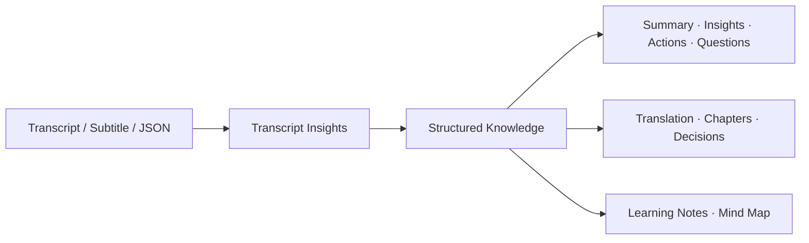

# Video Transcriber AI Skills

Official Agent Skills from [Video Transcriber AI](https://videotranscriber.ai/) — turn transcripts into structured knowledge.

[](LICENSE)

[English](README.md) | [简体中文](README_zh.md)

## What are Agent Skills?

Agent Skills are reusable instructions, references, and optional tools that teach an AI agent how to perform a workflow consistently. This repository maintains one canonical Skill source that works with Codex, Claude Code, and other Agent Skills-compatible tools.

## Available Skills

### transcript-insights

Transform transcripts and subtitles into:

- Executive Summary
- Key Insights
- Action Items
- Open Questions
- Translation
- Chapters
- Key Decisions
- Learning Notes
- Mind Map

When no output type is specified, the Skill returns Executive Summary, Key Insights, Action Items, and Open Questions.

## Workflow



## Demo

Official input:

[`official-video-subtitles.srt`](examples/transcript-insights/official-video-subtitles.srt) is sourced from the Video Transcriber AI official product video, [*Transcribe Video to Text from 2-Hour YouTube Videos with AI*](https://www.youtube.com/watch?v=e8WaTlzuid0).

Request:

```text
Use $transcript-insights to generate an Executive Summary, Key Insights, Chapters, Learning Notes, and a Mind Map.
```

See the complete [official expected output](examples/transcript-insights/official-video-expected-output.md).

The repository also includes a [workshop capability test](examples/transcript-insights/expected-output.md) for testing action items, decisions, missing deadlines, and anti-fabrication behavior.

## Installation

Review third-party Skills before installing them. The commands below install this repository from its public GitHub source.

### ChatGPT Desktop and Codex

Add the repository marketplace:

```bash
codex plugin marketplace add VideoTranscriberAI/videotranscriber-skills
```

Install the Plugin:

```bash
codex plugin add videotranscriber-skills@video-transcriber-ai
```

In the ChatGPT desktop app, open the Plugins Directory, select the **Video Transcriber AI** marketplace, and install **Video Transcriber AI Skills**.

### Codex CLI — Skill only

Clone the repository and copy or symlink the Skill into the Codex user Skills directory:

```bash
git clone https://github.com/VideoTranscriberAI/videotranscriber-skills.git
mkdir -p ~/.agents/skills
cp -R videotranscriber-skills/skills/transcript-insights ~/.agents/skills/
```

Restart Codex if the Skill does not appear immediately.

### Claude Code Plugin

Inside Claude Code:

```text
/plugin marketplace add VideoTranscriberAI/videotranscriber-skills
/plugin install videotranscriber-skills@video-transcriber-ai
/reload-plugins
```

The Plugin Skill is available as:

```text
/videotranscriber-skills:transcript-insights
```

### Claude Code — Skill only

```bash
git clone https://github.com/VideoTranscriberAI/videotranscriber-skills.git
mkdir -p ~/.claude/skills
cp -R videotranscriber-skills/skills/transcript-insights ~/.claude/skills/
```

The standalone Skill is available as `/transcript-insights`.

### Agent Skills CLI

For supported agents such as Codex, Claude Code, Cursor, GitHub Copilot, Windsurf, Gemini CLI, and Cline:

```bash
npx skills add VideoTranscriberAI/videotranscriber-skills
```

Follow the CLI prompt to select `transcript-insights` and the target agents.

### Manual project installation

Copy `skills/transcript-insights` to the project-specific Skills directory used by your agent:

- Codex: `.agents/skills/transcript-insights`
- Claude Code: `.claude/skills/transcript-insights`

## Usage

### Explicit invocation

Codex:

```text
Use $transcript-insights to generate Summary + Action Items from ./meeting.srt.
```

Claude Code standalone Skill:

```text
/transcript-insights Generate learning notes from the attached transcript.
```

Claude Code Plugin:

```text
/videotranscriber-skills:transcript-insights Translate these subtitles to Japanese.
```

### Automatic invocation

The Skill can trigger automatically when its description matches a request:

```text
Analyze this interview transcript and list the key insights and unresolved questions.
```

## Supported Inputs

The current instruction-only release accepts:

- pasted transcript or subtitle text
- attached `.txt`, `.md`, `.srt`, `.vtt`, or recognizable transcript `.json` files
- local file paths when the host agent has filesystem access

JSON input can contain a transcript string or a segment array using common `start`, `end`, `text`, and optional `speaker` fields. Video Transcriber AI JSON exports receive first-class handling, while ambiguous schemas require user selection rather than guesswork.

Raw audio, video, YouTube URLs, podcast URLs, and public media URLs require transcription before this Skill can analyze them.

## Output Rules

- Only requested sections are generated.
- Missing owners, deadlines, names, decisions, or timestamps are never guessed.
- Subtitle translation preserves cue order and timestamps.
- Chapters use source timestamps only when they exist.
- Mind maps use Mermaid when supported and fall back to a Markdown tree.

## Compatibility

Primary supported targets:

- ChatGPT Desktop with Codex
- Codex CLI
- Claude Code

The Skill and Plugin structures are validated against Codex and Claude schemas. The canonical `SKILL.md` also follows the open Agent Skills format and can be installed in other compatible tools. Platform-specific behavior may vary.

## Roadmap

Planned enhancements include Video Transcriber AI API support for audio, video, YouTube, podcasts, and public media URLs. API support will enhance the existing workflow rather than create a duplicate analysis Skill.

See [ROADMAP.md](ROADMAP.md) for the current scope.

## Privacy

The instruction-only Skill processes content in the host agent environment and does not call the Video Transcriber AI API. Data handling therefore depends on the host agent and its configuration.

Do not commit private meetings, customer subtitles, credentials, or confidential transcripts as examples. Repository examples must be fictional, public, or fully anonymized.

For the product privacy policy, see [Video Transcriber AI Privacy](https://videotranscriber.ai/privacy).

## Contributing

See [CONTRIBUTING.md](CONTRIBUTING.md) for contribution steps and [docs/ARCHITECTURE.md](docs/ARCHITECTURE.md) for repository boundaries and extension rules. New Skills must remain connected to current or planned Video Transcriber AI capabilities and must not duplicate existing workflows.

## License

Licensed under the [MIT License](LICENSE).

## Video Transcriber AI

Turn video and audio into accurate transcripts at [videotranscriber.ai](https://videotranscriber.ai/).
