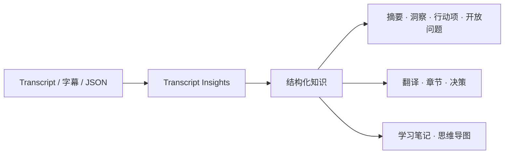

# Video Transcriber AI Skills

[Video Transcriber AI](https://videotranscriber.ai/) 官方 Agent Skills——将转录文本转化为结构化知识。

[](LICENSE)

[English](README.md) | [简体中文](README_zh.md)

## 什么是 Agent Skills？

Agent Skills 是一组可复用的指令、参考资料和可选工具，用来让 AI Agent 按一致的流程完成任务。本仓库维护一份 canonical Skill 源码，同时支持 Codex、Claude Code 以及其他兼容 Agent Skills 的工具。

## 已发布 Skills

### transcript-insights

将 transcript 和字幕转换为：

- Executive Summary
- Key Insights
- Action Items
- Open Questions
- Translation
- Chapters
- Key Decisions
- Learning Notes
- Mind Map

用户没有指定输出类型时，默认生成 Executive Summary、Key Insights、Action Items 和 Open Questions。

## 工作流程



## Demo

官方输入：

[`official-video-subtitles.srt`](examples/transcript-insights/official-video-subtitles.srt) 来自 Video Transcriber AI 官方产品视频 [*Transcribe Video to Text from 2-Hour YouTube Videos with AI*](https://www.youtube.com/watch?v=e8WaTlzuid0)。

调用：

```text
Use $transcript-insights to generate an Executive Summary, Key Insights, Chapters, Learning Notes, and a Mind Map.
```

查看完整的[官方预期输出](examples/transcript-insights/official-video-expected-output.md)。

仓库还提供一份 [Workshop 能力测试示例](examples/transcript-insights/expected-output.md)，用于测试 Action Items、Decisions、缺失截止日期和防虚构行为。

## 安装

安装第三方 Skill 前请先检查其内容。以下命令从公开 GitHub 仓库安装本项目。

### ChatGPT Desktop 与 Codex

添加仓库 Marketplace：

```bash
codex plugin marketplace add VideoTranscriberAI/videotranscriber-skills
```

安装 Plugin：

```bash
codex plugin add videotranscriber-skills@video-transcriber-ai
```

在 ChatGPT Desktop 中打开 Plugins Directory，选择 **Video Transcriber AI** Marketplace，然后安装 **Video Transcriber AI Skills**。

### Codex CLI——仅安装 Skill

```bash
git clone https://github.com/VideoTranscriberAI/videotranscriber-skills.git
mkdir -p ~/.agents/skills
cp -R videotranscriber-skills/skills/transcript-insights ~/.agents/skills/
```

如果 Skill 没有立即出现，请重启 Codex。

### Claude Code Plugin

在 Claude Code 中执行：

```text
/plugin marketplace add VideoTranscriberAI/videotranscriber-skills
/plugin install videotranscriber-skills@video-transcriber-ai
/reload-plugins
```

Plugin Skill 的调用方式：

```text
/videotranscriber-skills:transcript-insights
```

### Claude Code——仅安装 Skill

```bash
git clone https://github.com/VideoTranscriberAI/videotranscriber-skills.git
mkdir -p ~/.claude/skills
cp -R videotranscriber-skills/skills/transcript-insights ~/.claude/skills/
```

Standalone Skill 的调用方式为 `/transcript-insights`。

### Agent Skills CLI

适用于 Codex、Claude Code、Cursor、GitHub Copilot、Windsurf、Gemini CLI、Cline 等受支持 Agent：

```bash
npx skills add VideoTranscriberAI/videotranscriber-skills
```

根据 CLI 提示选择 `transcript-insights` 和目标 Agent。

### 手动安装到项目

将 `skills/transcript-insights` 复制到 Agent 对应的项目 Skills 目录：

- Codex：`.agents/skills/transcript-insights`
- Claude Code：`.claude/skills/transcript-insights`

## 使用方式

### 显式调用

Codex：

```text
Use $transcript-insights to generate Summary + Action Items from ./meeting.srt.
```

Claude Code Standalone Skill：

```text
/transcript-insights Generate learning notes from the attached transcript.
```

Claude Code Plugin：

```text
/videotranscriber-skills:transcript-insights Translate these subtitles to Japanese.
```

### 自动触发

当请求与 Skill description 匹配时，Agent 可以自动选择该 Skill：

```text
分析这份访谈 transcript，列出关键洞察和仍未解决的问题。
```

## 支持的输入

当前 instruction-only 版本支持：

- 直接粘贴 transcript 或字幕文本
- 上传 `.txt`、`.md`、`.srt`、`.vtt` 或可识别的 transcript `.json`
- 宿主 Agent 拥有文件系统权限时提供本地文件路径

JSON 可以包含完整 transcript 字符串，也可以包含由 `start`、`end`、`text` 和可选 `speaker` 字段组成的 segment 数组。Skill 会优先适配 Video Transcriber AI JSON 导出；遇到多个无法判断的候选字段时会询问用户，不会擅自合并或猜测。

原始音频、视频、YouTube URL、Podcast URL 和公开媒体 URL 目前需要先转录，再交给该 Skill 分析。

## 输出规则

- 只生成用户要求的部分。
- 不猜测缺失的负责人、截止日期、人名、决策或时间戳。
- 字幕翻译保留 cue 顺序和时间戳。
- Chapters 只使用输入中真实存在的时间。
- Mind Map 优先使用 Mermaid，不支持时回退为 Markdown 树。

## 兼容性

主要支持：

- ChatGPT Desktop with Codex
- Codex CLI
- Claude Code

Skill 和 Plugin 结构已经通过 Codex 与 Claude schema 校验。Canonical `SKILL.md` 同时遵循开放 Agent Skills 格式，可以安装到其他兼容工具，但不同平台的具体行为可能存在差异。

## Roadmap

后续计划通过 Video Transcriber AI API 增强现有 Skill，使 Agent 可以处理：

- 音频
- 视频
- YouTube URL
- Podcast URL
- 公开媒体 URL

API 将为现有 `transcript-insights` 提供 transcript，不会创建重复的分析 Skill。

详见 [ROADMAP.md](ROADMAP.md)。

## 隐私

当前 instruction-only Skill 不调用 Video Transcriber AI API，内容在宿主 Agent 环境中处理，具体数据策略由宿主 Agent 及其配置决定。

请勿向仓库提交私人会议、客户字幕、凭证或机密 transcript。公开示例必须是自有、已授权、公共领域或完全匿名的内容。

产品隐私政策：[Video Transcriber AI Privacy](https://videotranscriber.ai/privacy)。

## 参与贡献

贡献步骤详见 [CONTRIBUTING.md](CONTRIBUTING.md)，仓库边界和扩展规则详见 [docs/ARCHITECTURE.md](docs/ARCHITECTURE.md)。新 Skill 必须与 Video Transcriber AI 当前或规划中的产品能力直接相关，并避免与现有工作流重复。

## License

本项目采用 [MIT License](LICENSE)。

## Video Transcriber AI

访问 [videotranscriber.ai](https://videotranscriber.ai/)，将视频和音频转换为准确的 transcript。
