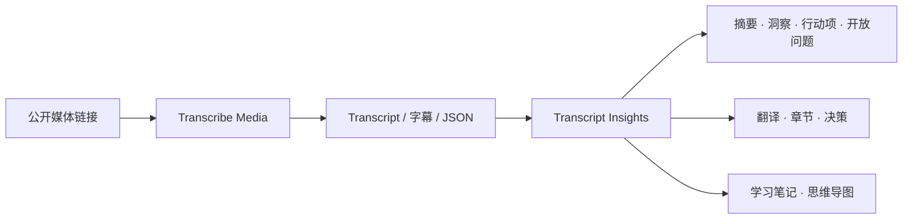

# Video Transcriber AI Skills

[Video Transcriber AI](https://videotranscriber.ai/) 官方 Agent Skills——转录公开媒体，并将转录文本转化为结构化知识。

[](https://github.com/VideoTranscriberAI/videotranscriber-skills/actions/workflows/validate-skills.yml)
[](https://github.com/VideoTranscriberAI/videotranscriber-skills/releases)
[](LICENSE)

[English](README.md) | [简体中文](README_zh.md)

## 什么是 Agent Skills？

Agent Skills 是一组可复用的指令、参考资料和可选工具，用来让 AI Agent 按一致的流程完成任务。本仓库维护一份 canonical Skill 源码，同时支持 Codex、Claude Code 以及其他兼容 Agent Skills 的工具。

## 已发布 Skills

### transcribe-media

通过 Video Transcriber AI MCP 服务完成：

- 转录公开音频、视频及支持的平台链接
- 选择基础或高级转录模型
- 启用说话人识别、声音事件、语音清理和 Keyterms
- 生成章节或翻译
- 获取转录全文及 SRT/VTT 字幕链接
- 安全地继续查询已有转录任务

该 Skill 需要配置 Video Transcriber AI MCP 连接。创建任务会消耗 API Quota。

### transcript-insights

将 transcript 和字幕转换为：

- Executive Summary
- Key Insights
- Action Items
- Open Questions
- Translation
- Chapters
- Key Decisions
- Learning Notes
- Mind Map

用户没有指定输出类型时，默认生成 Executive Summary、Key Insights、Action Items 和 Open Questions。

## 工作流程



## Demo

官方输入：

[`official-video-subtitles.srt`](examples/transcript-insights/official-video-subtitles.srt) 来自 Video Transcriber AI 官方产品视频 [*Transcribe Video to Text from 2-Hour YouTube Videos with AI*](https://www.youtube.com/watch?v=e8WaTlzuid0)。

调用：

```text
Use $transcript-insights to generate an Executive Summary, Key Insights, Chapters, Learning Notes, and a Mind Map.
```

查看完整的[官方预期输出](examples/transcript-insights/official-video-expected-output.md)。

仓库还提供一份 [Workshop 能力测试示例](examples/transcript-insights/expected-output.md)，用于测试 Action Items、Decisions、缺失截止日期和防虚构行为。

## 安装

安装第三方 Skill 前请先检查其内容。以下命令从公开 GitHub 仓库安装本项目。

### ChatGPT Desktop 与 Codex

添加仓库 Marketplace：

```bash
codex plugin marketplace add VideoTranscriberAI/videotranscriber-skills
```

安装 Plugin：

```bash
codex plugin add videotranscriber-skills@video-transcriber-ai
```

在 ChatGPT Desktop 中打开 Plugins Directory，选择 **Video Transcriber AI** Marketplace，然后安装 **Video Transcriber AI Skills**。

### Codex CLI——仅安装 Skill

```bash
git clone https://github.com/VideoTranscriberAI/videotranscriber-skills.git
mkdir -p ~/.agents/skills
cp -R videotranscriber-skills/skills/transcript-insights ~/.agents/skills/
cp -R videotranscriber-skills/skills/transcribe-media ~/.agents/skills/
```

如果 Skill 没有立即出现，请重启 Codex。

### Claude Code Plugin

在 Claude Code 中执行：

```text
/plugin marketplace add VideoTranscriberAI/videotranscriber-skills
/plugin install videotranscriber-skills@video-transcriber-ai
/reload-plugins
```

Plugin Skill 的调用方式：

```text
/videotranscriber-skills:transcript-insights
/videotranscriber-skills:transcribe-media
```

### Claude Code——仅安装 Skill

```bash
git clone https://github.com/VideoTranscriberAI/videotranscriber-skills.git
mkdir -p ~/.claude/skills
cp -R videotranscriber-skills/skills/transcript-insights ~/.claude/skills/
cp -R videotranscriber-skills/skills/transcribe-media ~/.claude/skills/
```

Standalone Skills 的调用方式为 `/transcript-insights` 和 `/transcribe-media`。

### Agent Skills CLI

适用于 Codex、Claude Code、Cursor、GitHub Copilot、Windsurf、Gemini CLI、Cline 等受支持 Agent：

```bash
npx skills add VideoTranscriberAI/videotranscriber-skills
```

根据 CLI 提示选择 `transcribe-media`、`transcript-insights` 或两者，并选择目标 Agent。

### 手动安装到项目

将 `skills/` 下需要的目录复制到 Agent 对应的项目 Skills 目录：

- Codex：`.agents/skills/transcribe-media` 或 `.agents/skills/transcript-insights`
- Claude Code：`.claude/skills/transcribe-media` 或 `.claude/skills/transcript-insights`

## 使用方式

### 显式调用

Codex：

```text
使用 $transcribe-media 转录这个公开媒体链接，并返回转录全文和 SRT 字幕链接。
```

```text
Use $transcript-insights to generate Summary + Action Items from ./meeting.srt.
```

Claude Code Standalone Skill：

```text
/transcript-insights Generate learning notes from the attached transcript.
```

Claude Code Plugin：

```text
/videotranscriber-skills:transcribe-media 使用基础模型转录这个公开媒体链接。
```

```text
/videotranscriber-skills:transcript-insights Translate these subtitles to Japanese.
```

### 自动触发

当请求与 Skill description 匹配时，Agent 可以自动选择该 Skill：

```text
分析这份访谈 transcript，列出关键洞察和仍未解决的问题。
```

## transcribe-media 的 MCP 配置

配置一个名为 `videotranscriber` 的 Streamable HTTP MCP 服务：

```text
URL: https://videotranscriber.ai/mcp
Authorization: Bearer YOUR_VS_API_KEY
```

在 Video Transcriber AI API 控制台创建 API Key，并将它保存在客户端连接设置中。不要把 Key 写进 Prompt 或提交到本仓库。Codex、Claude Code 和 JSON 配置示例参见 [MCP 接入说明](https://videotranscriber.ai/cn/code-docs/mcp)。

安装 Skill 与配置 MCP 连接是两个独立步骤。添加连接后重启或刷新客户端，并确认可以使用 `create_transcription`、`get_transcription` 和 `get_transcription_result`。

## 支持的输入

`transcribe-media` 支持公开可访问的 HTTP/HTTPS 媒体链接和已有的 Video Transcriber AI 任务 ID，不负责上传本地或私有文件。

`transcript-insights` 支持：

- 直接粘贴 transcript 或字幕文本
- 上传 `.txt`、`.md`、`.srt`、`.vtt` 或可识别的 transcript `.json`
- 宿主 Agent 拥有文件系统权限时提供本地文件路径

JSON 可以包含完整 transcript 字符串，也可以包含由 `start`、`end`、`text` 和可选 `speaker` 字段组成的 segment 数组。Skill 会优先适配 Video Transcriber AI JSON 导出；遇到多个无法判断的候选字段时会询问用户，不会擅自合并或猜测。

原始音频、视频、YouTube URL、Podcast URL 和公开媒体 URL 可以通过 `transcribe-media` 处理，具体来源以 MCP 服务支持范围为准。取得转录后，可继续交给 `transcript-insights` 分析。

## 输出规则

- 只生成用户要求的部分。
- 不猜测缺失的负责人、截止日期、人名、决策或时间戳。
- 字幕翻译保留 cue 顺序和时间戳。
- Chapters 只使用输入中真实存在的时间。
- Mind Map 优先使用 Mermaid，不支持时回退为 Markdown 树。

## 兼容性

主要支持：

- ChatGPT Desktop with Codex
- Codex CLI
- Claude Code

Skill 和 Plugin 结构已经通过 Codex 与 Claude schema 校验。Canonical `SKILL.md` 同时遵循开放 Agent Skills 格式，可以安装到其他兼容工具，但不同平台的具体行为可能存在差异。

## Roadmap

后续 Skill 会继续复用统一的转录与 transcript 分析工作流，避免重复定义相同能力。

详见 [ROADMAP.md](ROADMAP.md)。

## 隐私

`transcribe-media` 会通过已配置的 MCP 连接，将公开媒体链接和所选参数发送到 Video Transcriber AI。`transcript-insights` 在宿主 Agent 环境中处理用户提供的 transcript。具体数据策略同时取决于宿主 Agent 及其配置。

请勿向仓库提交私人会议、客户字幕、凭证或机密 transcript。公开示例必须是自有、已授权、公共领域或完全匿名的内容。

产品隐私政策：[Video Transcriber AI Privacy](https://videotranscriber.ai/privacy)。

## 参与贡献

贡献步骤详见 [CONTRIBUTING.md](CONTRIBUTING.md)，仓库边界和扩展规则详见 [docs/ARCHITECTURE.md](docs/ARCHITECTURE.md)。新 Skill 必须与 Video Transcriber AI 当前或规划中的产品能力直接相关，并避免与现有工作流重复。

## License

本项目采用 [MIT License](LICENSE)。

## Video Transcriber AI

访问 [videotranscriber.ai](https://videotranscriber.ai/)，将视频和音频转换为准确的 transcript。
