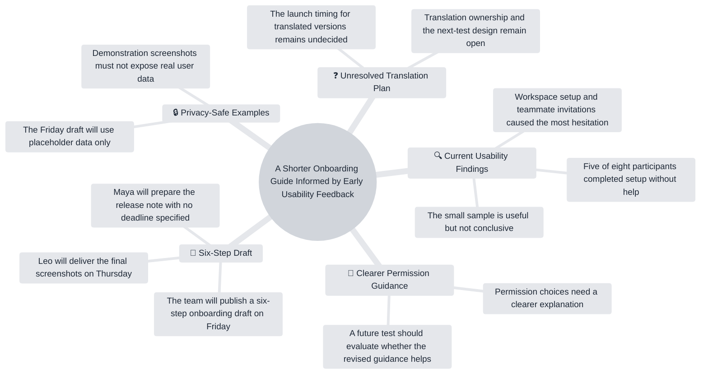

# Expected Output

## Executive Summary

The fictional team plans to publish a six-step onboarding draft on Friday. Usability feedback suggests that permissions need clearer explanation, but the eight-person sample is not conclusive. Screenshots are due Thursday and will contain placeholder data. The timing and ownership of translated versions remain unresolved.

## Key Insights

- Workspace setup and teammate invitations caused the most hesitation in the fictional usability sessions.
- Five of eight participants completed setup without help; the team explicitly treats this as a small, non-conclusive sample.
- Permission choices need clearer explanation and should be evaluated in a future test.

## Action Items

| Action | Owner | Due date | Evidence |
| --- | --- | --- | --- |
| Deliver final screenshots | Leo | Thursday | 01:10–01:34 |
| Prepare the release note | Maya | Not specified | 01:10 |

## Open Questions

- Will translated versions launch on Friday or wait for another review?
- Who will own translation?
- What design will be used for the next usability test?

## Chapters

- **00:00 — Workshop goal and current usability findings:** The team reviews problems in the twelve-step onboarding guide.
- **01:10 — Six-step draft and delivery plan:** The team plans a Friday draft and assigns screenshot and release-note work.
- **01:43 — Translation questions:** Launch timing and ownership remain unresolved.
- **02:12 — Future testing and privacy:** The team discusses proposed measures and confirms placeholder data.

## Key Decisions

- Publish a six-step onboarding draft on Friday.
- Use placeholder data only in the Friday draft.

The next-test design and translated-version launch timing were discussed but not decided.

## Learning Notes

### Core concepts

- Small usability samples can reveal friction but should not be treated as conclusive.
- Testing can combine completion-time measurements with explanations in participants' own words.

### Practical takeaways

- Focus the shorter guide on workspace setup, teammate invitations, and permissions.
- Keep test and demonstration screenshots free of real user data.

## Mind Map

