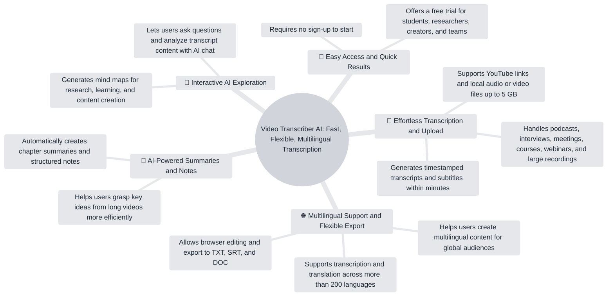

# Official Video Demo — Expected Output

## Executive Summary

Video Transcriber AI turns long-form video and audio into timestamped transcripts and subtitles. Users can provide a YouTube link or upload local files up to 5 GB, translate content across more than 200 languages, edit transcripts in the browser, and export TXT, SRT, or DOC files. The product also provides chapter summaries, structured notes, AI chat, and mind maps for deeper analysis.

## Key Insights

- The product is positioned for learners, researchers, creators, marketers, podcasters, and remote teams working with long-form media.
- Input options include YouTube links and local audio or video uploads up to 5 GB.
- Timestamped transcripts and clickable timestamps help users navigate important moments.
- Transcription and translation support more than 200 languages for multilingual content workflows.
- Outputs extend beyond transcripts to chapter summaries, structured notes, AI-assisted questions, analysis, and mind maps.

## Chapters

- **00:00:01 — Who the product is for and how to provide media:** The video introduces target users, YouTube links, local uploads, and the 5 GB file limit.
- **00:00:29 — Timestamped transcripts and multilingual support:** The product generates navigable transcripts and subtitles and supports translation across more than 200 languages.
- **00:00:57 — Editing, export, and collaboration:** Users can edit transcripts in the browser and export TXT, SRT, or DOC files for subtitles, notes, sharing, and teamwork.
- **00:01:26 — AI-powered knowledge tools:** Chapter summaries, structured notes, AI chat, analysis, and mind maps help users explore long videos.

## Learning Notes

### Core capabilities

- Convert YouTube and uploaded audio or video into timestamped text.
- Translate transcript content for multilingual audiences.
- Edit and export transcript content in several formats.
- Generate structured knowledge from long-form media.

### Practical workflows

- Use timestamps to return to important video moments.
- Export SRT for subtitle creation.
- Use structured notes and chapter summaries for faster review.
- Use AI chat and mind maps to explore relationships between ideas.

## Mind Map

