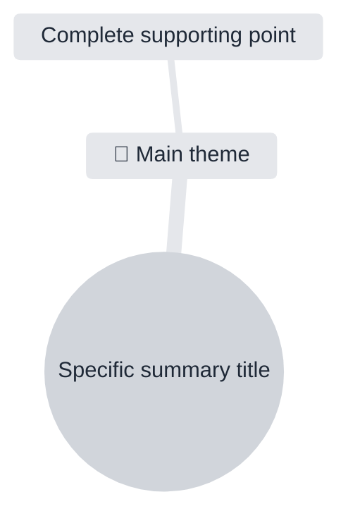

# Output Types

Use only the sections the user requests. When no sections are specified, use the four defaults defined in `SKILL.md`.

## Executive Summary

Write a concise synthesis of the transcript's purpose, main topics, and outcome. Prefer a short paragraph or 3–5 bullets. Do not turn minor details into headline conclusions.

## Key Insights

List the most useful findings, arguments, patterns, or lessons. Explain why each matters when the transcript supports that explanation. Keep observations distinct from explicit speaker claims.

## Action Items

Use a table when multiple actions exist:

| Action | Owner | Due date | Evidence |
| --- | --- | --- | --- |

Use `Not specified` for missing owners or deadlines. Include only actual commitments, requests, or clearly required follow-ups. If none exist, write `No explicit action items were identified.`

## Open Questions

List unresolved questions, missing information, dependencies, or points explicitly left open. Distinguish questions raised by speakers from gaps inferred during analysis. If none exist, say so.

## Translation

Translate either the full transcript or the requested analytical outputs according to the workflow in `SKILL.md`. For subtitle translation, keep the original file format, cue order, timestamps, and speaker labels.

## Chapters

Create chronological sections with descriptive titles and short summaries. Use source timestamps for chapter starts when reliable timestamps are present:

```text
00:00 Introduction and context
03:45 Main proposal
```

Each chapter start must exactly match an available source cue or segment start timestamp. Never interpolate or estimate a timestamp from text position within a cue. When source timestamps are sparse, create fewer chapters. Without timestamps, use ordered chapter headings and do not invent timecodes. Prefer meaningful topic changes over equal-length segmentation.

## Key Decisions

List decisions that participants explicitly made or clearly confirmed. For each decision, include the decision, rationale, owner, and relevant timestamp only when supported. If the transcript contains proposals but no confirmed decisions, write `No confirmed decisions were identified.`

## Learning Notes

Organize educational content for review:

- Core concepts
- Explanations and examples
- Practical takeaways
- Terms or definitions
- Review questions

Include only categories supported by the transcript. Do not manufacture definitions, examples, or answers.

## Mind Map

Use Mermaid `mindmap` by default. Match the Video Transcriber AI content structure while leaving visual styling and branch placement to the host renderer:

````markdown

````

- Write a concise, specific root title that summarizes the content rather than repeating only a product, file, or speaker name.
- Dynamically choose the number and depth of branches from the source. Use at least five first-level themes when the content is rich enough; do not pad sparse content.
- Add one relevant emoji to each first-level theme only. Do not add emojis to the root, deeper branches, or leaf points.
- Prefer complete, standalone statements for leaf points. Keep theme labels concise and avoid flat keyword dumps.
- Add deeper branches only when they clarify a real subtopic, relationship, or sequence.
- Keep branch sizes reasonably balanced, without dropping important content solely for symmetry.
- Derive every title, theme, and point from the transcript. Do not infer hidden patterns or unsupported conclusions.
- Match the user's requested output language.

Use the complete `cScale0`–`cScale11` and `cScaleLabel0`–`cScaleLabel11` palette shown above so Mermaid does not assign dark backgrounds to only some branches. Visual node shape, left/right placement, spacing, and export behavior still belong to the host renderer and cannot be guaranteed by the Skill. If Mermaid diagram configuration is unsupported, omit the configuration block and preserve the same content hierarchy. If Mermaid itself is unsupported or the user requests a Video Transcriber AI-compatible source outline, use this Markdown hierarchy:

```markdown
# Specific summary title
## 🎯 Main theme
- Complete supporting point
### Subtopic
- Complete supporting point
```

## Combining Outputs

- Preserve the order requested by the user.
- If no order is given, use the order listed in this file.
- Avoid duplicating the same detail across sections unless it serves a different purpose.
- Keep section-specific evidence rules even when several outputs are combined.
